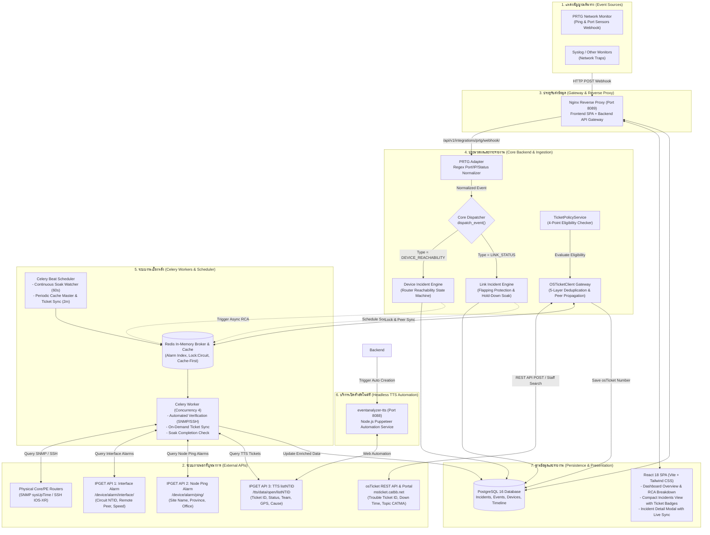
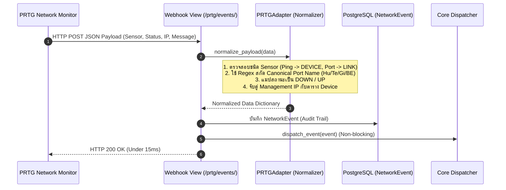
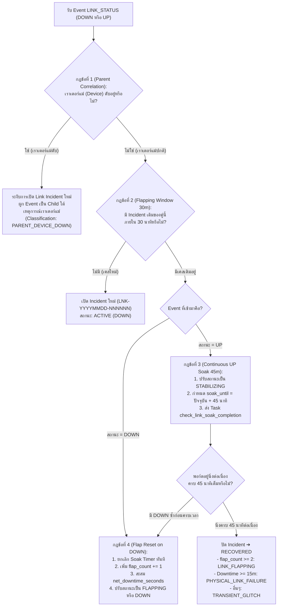
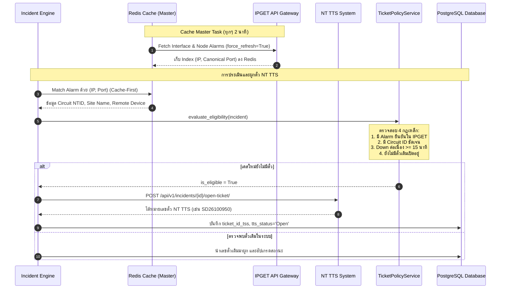
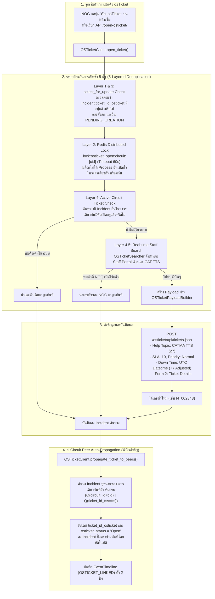

# คู่มือการทำงานของระบบ Multi-Source Network Event & Incident Analysis Platform (ฉบับปรับปรุงล่าสุด)
**System Workflow & Architecture Specification (Updated Edition - October 2026)**

เอกสารฉบับนี้อธิบาย **Workflow การทำงานของระบบ Multi-Source Network Event & Incident Analysis Platform (EventAnalyzer)** ทั้งหมดที่ได้รับการอัปเดต โดยครอบคลุมทั้งสถาปัตยกรรมหลัก, กลไก State Machine การคัดแยกความผิดปกติ, ระบบบูรณาการเชื่อมต่อ **IPGET API Suite**, ระบบเปิดใบงาน **NT TTS Trouble Ticket Automation**, ระบบ **osTicket (MSTicket) Gateway** พร้อมกลไก **5-Layered Deduplication** และ **Circuit Peer Auto-Propagation**, ระบบ Automated Verification, โครงสร้างฐานข้อมูลที่ขยายใหม่, การปรับปรุง User Interface (UI/UX) และมาตรการความทนทานต่อข้อผิดพลาด (Fault Tolerance)

---

## สารบัญ (Table of Contents)
1. [ภาพรวมสถาปัตยกรรมระบบหลังการอัปเดต (Updated System Architecture)](#1-ภาพรวมสถาปัตยกรรมระบบหลังการอัปเดต)
2. [ขั้นตอนที่ 1: การรับสัญญาณและการสกัดข้อมูลมาตรฐาน (Ingestion & Normalization Layer)](#2-ขั้นตอนที่-1-การรับสัญญาณและการสกัดข้อมูลมาตรฐาน)
3. [ขั้นตอนที่ 2: Core Dispatcher และ State Machine การจัดการ Incident](#3-ขั้นตอนที่-2-core-dispatcher-และ-state-machine-การจัดการ-incident)
4. [ขั้นตอนที่ 3: ระบบตรวจพิสูจน์สาเหตุรากเหง้าอัตโนมัติ (Automated RCA & Verification Engine)](#4-ขั้นตอนที่-3-ระบบตรวจพิสูจน์สาเหตุรากเหง้าอัตโนมัติ)
5. [ขั้นตอนที่ 4: สถาปัตยกรรม IPGET & NT TTS Integration (พร้อม Ticket Policy & Historical Integrity)](#5-ขั้นตอนที่-4-สถาปัตยกรรม-ipget--nt-tts-integration)
6. [ขั้นตอนที่ 5: สถาปัตยกรรม osTicket (MSTicket) Gateway & Circuit Peer Auto-Propagation](#6-ขั้นตอนที่-5-สถาปัตยกรรม-osticket-msticket-gateway--circuit-peer-auto-propagation)
7. [ขั้นตอนที่ 6: มาตรการรักษาเสถียรภาพ ประสิทธิภาพ และ Fault Tolerance](#7-ขั้นตอนที่-6-มาตรการรักษาเสถียรภาพ-ประสิทธิภาพ-และ-fault-tolerance)
8. [ขั้นตอนที่ 7: การปรับปรุงการแสดงผลและ User Experience (Frontend UI/UX Optimization)](#8-ขั้นตอนที่-7-การปรับปรุงการแสดงผลและ-user-experience)
9. [โครงสร้างฐานข้อมูลและฟิลด์ที่ได้รับการขยาย (Database Schema Reference)](#9-โครงสร้างฐานข้อมูลและฟิลด์ที่ได้รับการขยาย)
10. [คู่มือการทดสอบ ตรวจสอบ และวินิจฉัยระบบ (System Verification & Diagnostic Guide)](#10-คู่มือการทดสอบ-ตรวจสอบ-และวินิจฉัยระบบ)

---

## 1. ภาพรวมสถาปัตยกรรมระบบหลังการอัปเดต

ระบบทำงานในรูปแบบ **Containerized Microservices Stack 6 คอนเทนเนอร์** บน Docker โดยแยกหน้าที่กันอย่างชัดเจน และเชื่อมต่อกับระบบภายนอกแบบ Non-blocking:



### องค์ประกอบสำคัญของระบบ 6 คอนเทนเนอร์:
1. **Nginx Reverse Proxy** (`eventanalyzer-frontend:80`, Host: `8089`): จุดเข้าใช้งานจุดเดียว ทำหน้าที่ Route ข้อมูลไปยัง Frontend Static Assets, Django Backend API (`/api/`) และ Admin Portal
2. **Backend API & Dispatcher** (`eventanalyzer-backend:8000`): รันด้วย Django 5.0 + DRF + Gunicorn ทำหน้าที่ Core Ingestion, State Machines, osTicket Gateway, Ticket Policy Evaluation และ REST API
3. **Celery Worker & Beat** (`eventanalyzer-celery`): รัน Celery 5.4 แยกประมวลผลงานหนัก เช่น SNMP Verification, 45-minute Soak Timer, IPGET Cache Master Sync (ทุก 2 นาที) และ Background Peer Sync
4. **Redis 7.x** (`eventanalyzer-redis:6379`): ทำหน้าที่เป็น Message Queue, Distributed Lock (`lock:osticket_open:circuit:{cid}`) และ Cache-First Layer สำหรับข้อมูล Interface Alarms
5. **PostgreSQL 16** (`eventanalyzer-db:5432`): ฐานข้อมูลหลักพร้อม Transactional Integrity (`select_for_update`) สำหรับจัดการสถานะ Incident และ Audit Timeline
6. **TTS Automation Service** (`eventanalyzer-tts:8088`): รัน Node.js + Express + Chromium Puppeteer สำหรับให้บริการเปิดใบงานแจ้งซ่อมบนระบบ NT TTS อัตโนมัติ

---

## 2. ขั้นตอนที่ 1: การรับสัญญาณและการสกัดข้อมูลมาตรฐาน

ระบบรองรับ Event จากอุปกรณ์ตรวจวัด (Monitoring) หลากหลายค่าย โดยมีกระบวนการแปลงข้อมูล (Normalization Pipeline) เพื่อไม่ให้โครงสร้างเฉพาะของ PRTG หรือ Syslog ปะปนกับ Core Business Logic:



### การสกัดข้อมูลและแปลงรูปแบบพอร์ต (Interface Normalization):
ฟังก์ชัน `IPGETClient.normalize_port_name()` และ `PRTGAdapter.extract_interface_name()` จะทำความสะอาดชื่อพอร์ตให้อยู่ใน Canonical Short Form สากล เพื่อให้จับคู่ได้แม่นยำ 100%:
* `HundredGigE0/1/0/0` $\rightarrow$ `hu0/1/0/0`
* `TenGigabitEthernet0/0/0/31` หรือ `TenGigE0/0/0/31` $\rightarrow$ `te0/0/0/31`
* `GigabitEthernet0/1/2` $\rightarrow$ `gi0/1/2`
* `Bundle-Ether1` $\rightarrow$ `be1`

---

## 3. ขั้นตอนที่ 2: Core Dispatcher และ State Machine การจัดการ Incident

Core Dispatcher (`backend/events/engine.py`) จะตรวจสอบ `event.event_type` เพื่อส่งต่องานไปยัง Engine ที่รับผิดชอบโดยเฉพาะ:

### 3.1 Device Reachability Engine (เมื่อเราเตอร์หลักดับ)
มุ่งเน้นการตรวจจับการขาดหายไปของอุปกรณ์ (Node Down) และการป้องกันปัญหาเปิดเคสซ้ำซ้อน:
* **De-duplication**: หากได้รับ Ping DOWN ซ้ำในขณะที่ Incident เดิมยังไม่ปิด ระบบจะบันทึก Timeline เป็น `DOWN_REPEAT` โดยไม่เปิด Incident ใหม่
* **Recovery Trigger**: เมื่อได้รับสัญญาณ Ping UP ระบบจะเปลี่ยนสถานะเป็น `RECOVERY_CHECK` และเรียกใช้งาน Automated Verification Engine แบบ Asynchronous

---

### 3.2 Link Incident & Flapping Engine (เมื่อสายสัญญาณ/พอร์ตขัดข้อง)
สร้างขึ้นตามมาตรฐาน **Carrier-Grade Flapping Protection** โดยยึด **4 กฎเหล็ก**:



---

## 4. ขั้นตอนที่ 3: ระบบตรวจพิสูจน์สาเหตุรากเหง้าอัตโนมัติ

ระบบมีโมดูล **Automated RCA & Verification Engine** (`backend/verification/`) เพื่อค้นหาสาเหตุที่แท้จริงของการหยุดทำงานของเครือข่าย โดยใช้ Strategy Pattern:
* **SNMP sysUpTime Verification**: ตรวจสอบ Uptime ของเราเตอร์หลังจาก Ping กลับมาติด หาก Uptime < 3,600 วินาที แสดงว่าเครื่องเพิ่งสตาร์ตใหม่จากการรีบูต (Reboot) แต่หาก Uptime ยาวนานต่อเนื่องแสดงว่าเกิดจากสายสัญญาณขาดภายนอก (`CONNECTIVITY_LOSS`)
* **SSH IOS-XR Automation**: กรณีอุปกรณ์เป็น Cisco IOS-XR ระบบสามารถล็อกอินผ่าน SSH รันคำสั่ง `show reboot-history` หรือตรวจสอบ OID `whyReload` เพื่อระบุสาเหตุการรีโหลดได้อย่างแม่นยำ (เช่น Power Outage, Kernel Panic, User Reload)

---

## 5. ขั้นตอนที่ 4: สถาปัตยกรรม IPGET & NT TTS Integration

ระบบเชื่อมต่อกับ **IPGET Network Monitoring Suite** และ **NT TTS Trouble Ticket System** ด้วยสถาปัตยกรรม Cache-First:



### การปกป้องความถูกต้องของข้อมูลประวัติตั๋วย้อนหลัง (Historical Data Integrity):
1. **Stale Completed Ticket Skip**: เมื่อตรวจสอบข้อมูลย้อนหลังจาก TTS API หากพบว่าตั๋วของวงจรนั้นมีสถานะ `Complete`, `Closed`, หรือ `Resolved` โดยมีเวลา `FAULT_DATE` ก่อนเวลาที่ Incident ปัจจุบัน Down เกิน 6 ชั่วโมง ระบบจะไม่นำตั๋วเก่าที่ปิดไปแล้วมาผูกซ้ำ
2. **Smart Ticket Upgrade**: หาก Incident กำลัง Active อยู่ และมีตั๋วใหม่สถานะ `Work In Progress` เกิดขึ้นในระบบ ระบบจะอัปเกรดเลขตั๋วรอบปัจจุบันให้เป็นตั๋วล่าสุดทันที
3. **No Overwrite on History**: Incident เก่าในอดีตที่ปิดสถานะเป็น `RECOVERED` ไปแล้ว จะไม่มีการแก้ไขหรือเขียนทับเลขตั๋วเดิมของตนเองโดยเด็ดขาด ข้อมูลประวัติการ Down แต่ละครั้งยังคงบันทึกเลขตั๋วแยกกันอย่างถูกต้อง 100%

---

## 6. ขั้นตอนที่ 5: สถาปัตยกรรม osTicket (MSTicket) Gateway & Circuit Peer Auto-Propagation

เพื่อเชื่อมโยงระบบ Incident เข้ากับระบบ Helpdesk กลางขององค์กร (**MSTicket: `https://msticket.catbb.net/`**) ระบบได้พัฒนาโมดูล [`backend/integrations/osticket/`](file:///root/container/event-analyzer/backend/integrations/osticket/) ขึ้นมาโดยเฉพาะ:



### รายละเอียดฟังก์ชันสำคัญของ osTicket Gateway:
1. **Circuit Peer Auto-Propagation**:
   - ในโครงสร้างเครือข่าย วงจร Point-to-Point เมื่อเกิด Down จะสร้าง Incident ขึ้น 2 รายการสำหรับอุปกรณ์หัว-ท้าย (Node A และ Node B)
   - เมื่อเจ้าหน้าที่กดเปิดตั๋ว osTicket ที่ฝั่งใดฝั่งหนึ่ง ระบบจะ **ค้นหา Incident คู่ขนานของวงจรเดียวกัน (`circuit_id` หรือ `ticket_id_tss` เดียวกัน) และนำเลขตั๋ว osTicket ไปบันทึกให้อีกฝั่งโดยอัตโนมัติทันที** ทั้งสองฝั่งจึงแสดงผลตั๋วตรงกันเสมอ
2. **Background & On-Demand Fallback Sync**:
   - ใน [`IncidentEnrichmentService`](file:///root/container/event-analyzer/backend/incidents/services/enrichment_service.py) ฟังก์ชัน `_enrich_single_link` จะตรวจเช็กว่าหาก Incident ตัวใดยังไม่มี `ticket_id_osticket` จะทำการดึงเลขตั๋วจาก Peer Incident หรือค้นหาตรงไปยัง osTicket เพื่อนำมาผูกให้อัตโนมัติ
   - เมื่อกดปุ่ม **"ซิงค์ Ticket"** ใน Modal หน้าบ้าน ข้อมูล `ticket_id_osticket` จะได้รับการอัปเดตแบบ Real-time
3. **Timezone Precision (+7 UTC Conversion)**:
   - ฟังก์ชัน `OSTicketPayloadBuilder.format_down_time()` จะแปลงเวลาเหตุการณ์ Down จากเวลาไทย (Asia/Bangkok) ให้เป็นเวลาสากล **UTC (`%Y-%m-%d %H:%M:%S`)** ก่อนส่งไปยัง REST API
   - เมื่อ PHP Engine ของ osTicket แสดงผลผ่าน Staff Web Portal จะทำการบวกชดเชย +7 ชั่วโมงเข้าสู่เวลาท้องถิ่นไทย ทำให้ค่า **`Down Time` บนหน้าเว็บ osTicket แสดงผลตรงกับเวลาที่เกิดเหตุจริง 100% ไม่เลื่อนไปข้างหน้า 7 ชม. อีกต่อไป**

---

## 7. ขั้นตอนที่ 6: มาตรการรักษาเสถียรภาพ ประสิทธิภาพ และ Fault Tolerance

การเชื่อมต่อกับระบบภายนอก (IPGET, NT TTS, osTicket) มีการออกแบบเพื่อป้องกันความเสี่ยงอย่างเข้มงวด:
1. **Asynchronous Non-blocking Ingestion**: การรับ Webhook จาก PRTG จะไม่รอผลจากภายนอก โดยบันทึก Event ลงฐานข้อมูลและตอบกลับ PRTG ด้วย `HTTP 200` ภายในเวลา $< 15$ ms เสมอ
2. **Strict Timeout Budgets**: กำหนด Timeout ไว้ที่ 6 วินาทีสำหรับ IPGET Alarms, 25 วินาทีสำหรับ TTS API, และ 30 วินาทีสำหรับ osTicket API ป้องกันปัญหา Worker Thread ค้าง
3. **Distributed Locking**: ป้องกัน Race Condition เมื่อมีการกดยิงเปิดตั๋วพร้อมกัน หรือมี Event ซ้ำเข้ามาในเสี้ยววินาทีเดียวกันด้วย Redis Lock
4. **Graceful Fallback**: หากระบบภายนอกขัดข้อง ช้า หรือตอบสนองด้วย HTTP Error ระบบจะบันทึกสถานะ `FAILED_NEEDS_VERIFY` หรือข้ามไปทำงานรอบถัดไป โดยไม่ทำให้ระบบ Core Incident หรือการคำนวณ Downtime เสียหาย

---

## 8. ขั้นตอนที่ 7: การปรับปรุงการแสดงผลและ User Experience

การแสดงผลหน้า **Incidents Management View** ([`IncidentsView.tsx`](file:///root/container/event-analyzer/frontend/src/components/IncidentsView.tsx)) และ Modal รายละเอียด:

### 1. การแสดงตั๋วคู่ (Dual Ticket Badges):
* **NT TTS Ticket Badge**: กล่องสีส้มทองแสดงหมายเลขใบงาน เช่น `SD26096232` พร้อมป้ายสถานะ `OPEN` หรือ `WIP`
* **osTicket Badge**: กล่องสีน้ำเงินเข้มพร้อมไอคอนตั๋ว แสดงหมายเลข `NT002843` พร้อมป้ายสถานะ `OPEN` และสามารถคลิกเพื่อเปิดหน้าเว็บ `msticket.catbb.net` ได้โดยตรง
* ทั้งอุปกรณ์ต้นทางและปลายทางของวงจรเดียวกัน จะแสดงป้ายตั๋วทั้งสองใบตรงกันเสมอ

### 2. Compact Vertical Stacking Layout:
* ปรับปรุงคอลัมน์ "Status & Action" เป็นแนวตั้ง ลดความกว้างจาก ~300px เหลือเพียง **~120px** (ประหยัดพื้นที่แนวนอนไปได้มากกว่า **55%**)

### 3. TTS Work Order Card ใน Incident Detail Modal:
* แสดงรายละเอียดใบงาน NT TTS, ข้อมูลวงจร, พิกัด GPS, ทีมช่างผู้รับผิดชอบ, สาเหตุจริง (Actual Cause) และวิธีแก้ไข (Resolution)
* แสดงป้าย osTicket ลิงก์ตรงสู่ระบบ Helpdesk
* ปุ่ม **"ซิงค์ Ticket"** สำหรับดึงข้อมูลล่าสุดของทั้ง NT TTS และ osTicket ได้ทันทีเพียงคลิกเดียว

---

## 9. โครงสร้างฐานข้อมูลและฟิลด์ที่ได้รับการขยาย

ตาราง `incidents_incident` ในโมเดล Django ([`incidents/models.py`](file:///root/container/event-analyzer/backend/incidents/models.py)) ประกอบด้วยฟิลด์สำคัญ:

| ชื่อฟิลด์ใน Database | ชนิดข้อมูล (Data Type) | แหล่งที่มาของข้อมูล | คำอธิบายการใช้งาน |
| :--- | :--- | :--- | :--- |
| `incident_number` | `CharField(50)` | System Generator | รหัสเหตุการณ์ (เช่น `LNK-20261013-000004`) |
| `incident_type` | `CharField(10)` | Normalizer / Engine | ประเภท Incident (`LINK` หรือ `DEVICE`) |
| `site_name` | `CharField(255)` | IPGET API 1 & 2 | ชื่อชุมสาย / สถานีฐาน หรือศูนย์โทรคมนาคม |
| `circuit_id` | `CharField(100)` | IPGET API 1 / Regex | รหัสวงจร NTID ของสายสัญญาณ (เช่น `TBB0005562+TBB147010`) |
| `remote_device` | `CharField(255)` | IPGET API 1 | ชื่อเราเตอร์หรืออุปกรณ์ฝั่งปลายทาง (`destname`) |
| `remote_interface` | `CharField(100)` | IPGET API 1 | พอร์ตปลายทางของวงจร (`destport`) |
| `ticket_id_tss` | `CharField(100)` | IPGET API 1 & 3 / TTS | หมายเลขใบสั่งงาน NT TTS (เช่น `SD26096232`) |
| `tts_status` | `CharField(100)` | IPGET API 3 / TTS | สถานะงานแก้ NT TTS (เช่น `Open`, `Work In Progress`) |
| `ticket_id_osticket` | `CharField(100)` | osTicket Gateway | หมายเลข Trouble Ticket บน osTicket (เช่น `NT002843`) |
| `osticket_status` | `CharField(50)` | osTicket Gateway | สถานะตั๋ว osTicket (เช่น `Open`, `PENDING_CREATION`) |
| `repair_team` | `CharField(255)` | IPGET API 3 | ทีมช่างผู้รับผิดชอบงานแก้ (`REPAIRTEAM`) |
| `response_department` | `CharField(255)` | IPGET API 3 | หน่วยงานต้นสังกัดผู้รับผิดชอบ (`RESPONSE_DEPARTMENT`) |
| `actual_cause` | `TextField` | IPGET API 3 | สาเหตุจริงของปัญหาจากใบสั่งงาน |
| `resolution` | `TextField` | IPGET API 3 | วิธีการแก้ไขปัญหา / ผลการซ่อมบำรุง |
| `flap_count` | `IntegerField` | Link Engine | จำนวนรอบการกระพริบสะสมภายในหน้าต่างเวลา 30 นาที |
| `soak_until` | `DateTimeField` | Link Engine | เวลาสิ้นสุดการรอดูอาการความเสถียร 45 นาที |
| `net_downtime_seconds` | `BigIntegerField` | Link Engine | เวลาที่ระบบดับจริงสะสม (ไม่นับช่วงรอดูอาการ) |

---

## 10. คู่มือการทดสอบ ตรวจสอบ และวินิจฉัยระบบ

### 10.1 คำสั่งตรวจสอบสถานะ Incident และตั๋วคู่ผ่าน API
```bash
# ค้นหาเหตุการณ์ตามรหัสวงจร (เช่น TBB147010)
curl -s "http://localhost:8089/api/v1/incidents/?search=TBB147010" | python3 -c "
import sys, json
data = json.load(sys.stdin)
for item in data.get('results', []):
    print(item['id'], item['incident_number'], item['device_name'], item['circuit_id'], item['ticket_id_tss'], item['ticket_id_osticket'], item['osticket_status'])
"
```

### 10.2 คำสั่งทดสอบ On-Demand Ticket Sync API
สั่ง Trigger ให้ระบบซิงค์ข้อมูลทั้ง NT TTS และ osTicket สำหรับ Incident ที่ระบุ:
```bash
curl -s -X POST http://localhost:8089/api/v1/incidents/254/sync-ticket/ \
  -H "Content-Type: application/json" | python3 -m json.tool
```

### 10.3 คำสั่งทดสอบการเปิด osTicket และ Peer Auto-Propagation ผ่าน Django Shell
```bash
docker exec -it eventanalyzer-backend python manage.py shell -c "
from integrations.osticket.client import OSTicketClient
from incidents.models import Incident

client = OSTicketClient()
inc = Incident.objects.get(id=253)

# ทดสอบรัน Peer Propagation ไปยัง Incident คู่ขนาน
count = client.propagate_ticket_to_peers(inc, 'NT002843', circuit_id=inc.circuit_id, cat_tts=inc.ticket_id_tss)
print(f'Peer propagation updated: {count} incidents')
"
```

### 10.4 คำสั่ง Rebuild Frontend และ Reload Nginx
เมื่อมีการปรับแต่งแก้ไขโค้ดฝั่งหน้าบ้าน:
```bash
cd /root/container/event-analyzer/frontend && npm run build
docker exec eventanalyzer-frontend nginx -s reload
```

---
*เอกสารนี้รวบรวมและจัดทำขึ้นเพื่อเป็นมาตรฐานการทำงานของระบบ Multi-Source Network Event & Incident Analysis Platform ประจำปี 2026*
